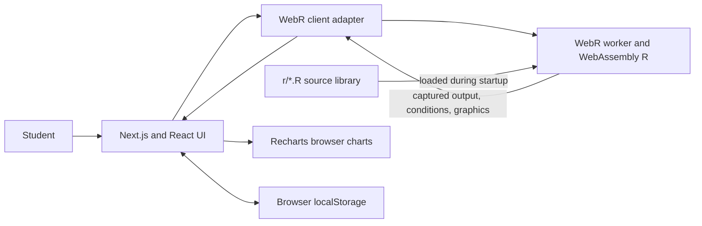

# StatLab

**Explore data. Simulate ideas. Think statistically.**

StatLab is an interactive R programming and statistics learning lab for students who learn best by trying code and inspecting what it computes. It brings an R playground, focused lessons, small datasets, statistical summaries, simulations, charts, and beginner challenges into one browser workspace.

StatLab was developed as an independent student learning and engineering project connected to studying R through NPTEL SWAYAM as part of my college open elective. It is not an official course tool, and it does not reproduce course material.

> StatLab is an independent educational project created for learning and experimentation. It is not affiliated with, endorsed by, or an official product of NPTEL or SWAYAM.

## Features

- Client-side R execution through WebR, including printed results, warnings, messages, errors, and base R graphics where supported.
- R playground with starter examples, syntax-colored editor, Ctrl/Cmd+Enter, copy, reset, clear output, locally remembered code, and `.R` download.
- Interactive lessons for R fundamentals, vectors and matrices, and data frames.
- R-backed descriptive statistics, seeded dice simulation, and histogram bin calculations.
- Dataset explorer with teaching datasets, search, and local CSV import/export (2 MB import limit).
- Five beginner exercises checked by executing their conditions in R.
- Locally stored theme, run count, recent activity, and completed challenge progress. No account is required.
- Responsive dark/light interface with a mobile navigation drawer.

The interface uses Recharts to display chart-ready counts and values computed in R. The charts themselves are rendered in the browser. CSV import is browser-local and imported tables are currently browsable/exportable; the built-in R-backed analyses use the included R teaching datasets.

## Screenshots

to be added 

1. Dashboard: `public/screenshots/dashboard.png`
2. Playground with a real R result: `public/screenshots/playground.png`
3. Statistics lab: `public/screenshots/statistics.png`
4. Probability simulation: `public/screenshots/probability.png`
5. R-powered histogram: `public/screenshots/visualization.png`

After adding captures, embed them here with Markdown image links. Do not use mockups or fabricated output as screenshots.

## Live demo

(https://stat-lab-ruddy.vercel.app/)

## Technology stack

- **Next.js App Router** serves the application shell and page.
- **React and TypeScript** implement typed interactive UI and client state.
- **Tailwind CSS 4** is configured alongside a small custom CSS design system.
- **WebR 0.6.0** runs the R interpreter compiled to WebAssembly in a browser worker. There is no R server in the execution path.
- **Recharts** renders charts from values calculated by R; **Lucide** supplies icons.
- **Zod** validates CSV table structure; **Vitest** tests CSV handling.

The frontend handles navigation, editor input, local persistence, and presentation. WebR evaluates user code and the included R helpers in the browser. The UI formats the runtime's captured output and displays returned graphics; it does not fabricate substitute results.

## Architecture



At page startup, the client-only adapter dynamically imports WebR, initializes its worker, then fetches the published R source modules from `/r/` and evaluates them in the runtime. Playground runs use WebR's `Shelter.captureR()` with stream and graphics capture. A small R-side console wrapper parses and evaluates expressions sequentially, prints visible values, and turns R parse/runtime conditions into readable output. Statistical screens call the same R helper functions and map their returned values to UI output or chart series. Errors during initialization are shown in the runtime status; failed R expressions appear as errors and do not produce a success state. Each capture shelter is purged after the run.

WebR runs locally in the browser and does not send code or CSV contents to a StatLab backend. Browser-local storage is used for learning preferences/activity and the last playground code. Clearing site data removes this local information.

## Repository structure

```text
src/
  app/                 App Router page, layout, and styles
  components/           StatLab workspace and interactive modules
  lib/                  WebR adapter and CSV validation/serialization
r/
  variables_types.R
  vectors_matrices.R
  data_frames.R
  control_flow_functions.R
  descriptive_statistics.R
  probability_simulations.R
  hypothesis_testing.R
  regression.R
  data_visualization.R
  datasets.R
  examples/             runnable R examples
  tests/                native R validation script
scripts/
  copy-r-sources.mjs    publishes R source modules under public/r
  test-webr.mjs         direct Node WebR verification script
public/r/               generated copy served to the browser
tests/                  Vitest CSV tests
```

The authored `.R` files contain helper implementations used by lessons and the statistics, probability, dataset, and visualization workflows. `public/r/` is copied from `r/` before development and production builds; edit the authored source under `r/`.

## Prerequisites and local development

- Node.js 20.9 or later (required by the selected Next.js release).
- npm (the repository includes `package-lock.json`).
- A modern browser with WebAssembly, Web Workers, and WebAssembly threads support as needed by WebR. Native R is not required for the in-browser runtime.
- Native R is only needed if you want to run `r/tests/test-statlab.R` outside WebR.

```bash
npm install
npm run dev
```

Open `http://localhost:3000`. The first load downloads/initializes WebR and may take a short while; the status changes to **WebR ready** when the runtime and R helper files are loaded.

Other project commands:

```bash
npm run lint
npm run typecheck
npm test
npm run build
npm start
```

`npm run build` first copies `r/*.R` to `public/r/`. The Node runtime script is available as `npm run test:runtime`; on Windows, WebR 0.6.0 currently fails to construct its Node worker from the package's worker URL (`ERR_WORKER_PATH`). The real-browser runtime has been verified in the app; this Node-only limitation does not affect browser execution. The native R script may be run with `Rscript r/tests/test-statlab.R` if R is installed.

## Running R code

1. Open **R Playground** from the left navigation.
2. Enter R code or choose one of the included examples.
3. Wait for the top-bar status to show **WebR ready**, then select **Run** or press Ctrl/Cmd+Enter.
4. Read captured R output, warnings, messages, or errors in the console panel. Use **Clear**, **Reset**, **Copy**, or **Download** for the editor workflow.
5. The last playground code is saved in this browser. Theme, recent activity, run count, and challenge progress are also local to this browser.

WebR is a real R runtime compiled to WebAssembly. It supports normal base R expressions, vectors, matrices, data frames, functions, control flow, and many statistical functions. Native system calls, arbitrary CRAN packages, and some operations requiring unavailable WebAssembly features are not supported. Keep long computations bounded: browser workers improve responsiveness, but memory and execution resources still belong to the user's device. Refreshing the page reinitializes WebR and resets the current R session.

## Tests and verification

- `npm test` runs the Vitest suite for CSV parsing, validation, and round trips.
- `npm run lint` runs ESLint.
- `npm run typecheck` runs TypeScript strict checking.
- `npm run build` compiles the production Next.js app and prepares served R files.
- `npm run test:runtime` is configured for direct WebR checks in Node, but has the Windows worker URL limitation described above.
- `Rscript r/tests/test-statlab.R` is a native R test script and requires an installed R distribution.

The playground has also been exercised in a real browser using WebR: the required vector `mean()`/`sd()` example returned 30 and 15.81139; a data-frame score mean returned 83.33333; a seeded 1,000-sample Bernoulli mean returned 0.501 in that runtime; and a missing object displayed an R error. Simulation results are properties of the actual seeded R runtime, not hardcoded UI values.


## Browser compatibility and limitations

WebR requires a modern browser that supports WebAssembly and Web Workers; startup downloads runtime assets and needs network access. Runtime startup time and memory use depend on device/browser. Only packages built and made available for WebAssembly can work; desktop R packages and system-dependent operations are not generally interchangeable. The current interface does not install packages, interrupt an active R computation, or persist the R session across reloads. Avoid unbounded loops. Charts use Recharts with R-produced values rather than a graphics device for those modules. Imported CSV files are parsed locally and currently do not automatically become R data frames.

## Roadmap

- Connect imported CSV tables to safe R-side data-frame analysis.
- Add an explicit stop/reset control for active computations if supported by the runtime lifecycle.
- Add broader component and browser tests against WebR in a real browser.
- Capture and include real desktop/mobile screenshots.
- Deploy to Vercel and verify worker, WebAssembly, and isolation headers on the production domain.
- Add more lessons and visual explanations for inference and regression.

## Contributing

1. Fork the repository and create a focused feature branch.
2. Make the change, add or update meaningful R or TypeScript tests, and keep the R helpers connected to the UI.
3. Run `npm run lint`, `npm run typecheck`, `npm test`, and `npm run build` where applicable.
4. Open a pull request describing the change and its verification.

## License

No separate open-source license has been specified for this project. Unless and until a license is added, the project's original code remains subject to applicable copyright law. Public visibility on GitHub does not, by itself, grant general permission to reuse, modify, or redistribute the code.

Third-party dependencies and assets may have their own licenses.

## Acknowledgments and references

- [WebR documentation](https://docs.r-wasm.org/webr/latest/) — browser-based R runtime and API.
- [Next.js documentation](https://nextjs.org/docs)
- [React documentation](https://react.dev/)
- [Recharts documentation](https://recharts.org/)
- [Tailwind CSS documentation](https://tailwindcss.com/docs)

Third-party dependencies retain their own licenses; see their respective project documentation and package metadata.
